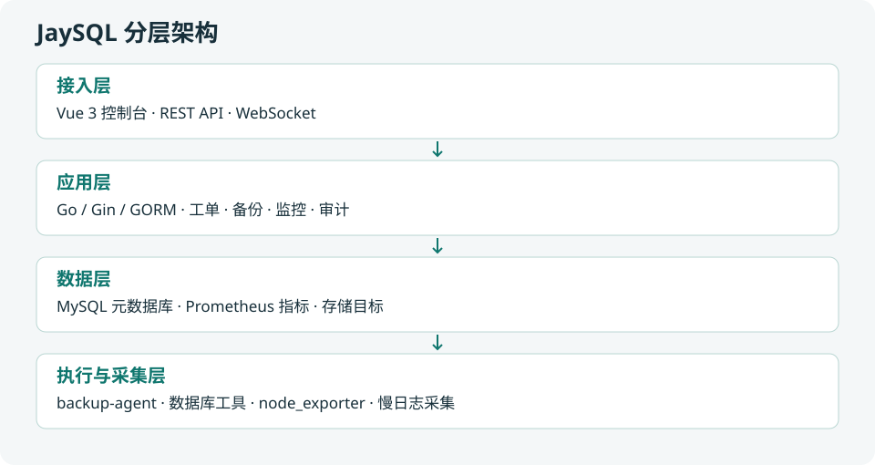

# JaySQL

<p align="center">
  <b>面向数据库运维与研发协作的一体化管理平台</b>
</p>

<p align="center">
  <a href="LICENSE"></a>
  
  
  <a href="https://github.com/simajiong/JaySQL/releases"></a>
  
</p>

JaySQL 把「查询与变更、备份与恢复、性能与监控、审计与权限」收敛到同一个控制台：纳管多引擎实例，
SQL 查询受数据授权约束，变更走工单 + 规范预审 + 审批流，备份可定时可恢复，慢 SQL 与指标有统一视图，所有动作留痕可回放。

> 平台只保存**元数据、任务记录与审计**，不代持业务数据 —— 业务数据始终停留在被管实例与存储目标上。

---

## 功能模块

| 模块 | 关键能力 | 入口 |
| :--- | :------- | :--- |
| 首页 | 实例总览、待办与风险、快捷入口 | `/home` |
| AI 助手 | 服务商接入、模型管理、SQL 生成与优化建议、文档问答 | `/ai` |
| SQL 工作台 | 在线查询（受数据授权约束）、新建工单、工单列表与详情 | `/sql-workbench` |
| 备份恢复 | 备份任务、备份集、存储目标、恢复向导（含预检与二次确认） | `/backup` |
| 性能分析 | 性能概览、慢 SQL 采集与治理、负载快照 | `/performance` |
| 监控告警 | 监控大屏、实例明细、健康分、告警中心与多渠道通知 | `/monitor` |
| 安全审计 | 操作日志、策略配置 | `/audit` |
| 系统管理 | 用户 / 角色 / 权限点、数据访问授权、环境、系统配置 | `/admin` |
| 文档中心 | 产品文档（随代码构建）、AI 文档问答 | `/docs` |

一次典型路径：纳管实例 → 授权研发可查哪些库 → 自助查询 / 提交变更工单 → DBA 审批执行 → 定时备份与恢复演练 → 慢了查慢 SQL → 出事看监控告警 → 事后查审计。

---

## 支持的数据库

能力随引擎逐步落地，下表为**当前已实现**的口径：

| 引擎 | SQL 查询 | SQL 审核 | 变更工单 | 备份恢复 | 监控采集 | 慢SQL |
| :--- | :---: | :---: | :---: | :---: | :---: | :---: |
| **MySQL** | ✅ | ✅ | ✅ | ✅ | ✅ | ✅ |
| **PostgreSQL** | ✅ | ✅ | ✅ | ✅ | ✅ | ✅ |
| **Oracle** | ✅ | ✅ | ✅ | ❌ | ✅ | ✅ |
| **SQL Server** | ✅ | ❌ | ❌ | ❌ | ✅ | ❌ |
| **TiDB** | ✅ | ✅ | ✅ | ✅ | ✅ | ❌ |
| **ClickHouse** | ✅ | ❌ | ❌ | ❌ | ❌ | ❌ |
| **Doris** | ✅ | ❌ | ❌ | ❌ | ❌ | ❌ |
| **OceanBase** | ✅ | ❌ | ❌ | ❌ | ❌ | ❌ |

SQL 审核内置 **279 条标准规则**：MySQL 82、TiDB 82、PostgreSQL 58、Oracle 57，
支持全局与实例级参数配置、规则开关与级别调整（级别唯一数据源是 `insight_sql_standard_rules.level`）。

---

## 架构



| 层 | 组成 | 说明 |
| :-- | :--- | :--- |
| 接入层 | Vue 3 + Ant Design Vue 控制台、REST API、WebSocket 日志推送 | 唯一用户入口 |
| 应用层 | Go + Gin + GORM，含工作台 / 工单 / 备份 / 监控 / 性能 / 审计与定时 cron | 业务编排与调度 |
| 数据层 | 元数据库（MySQL）、指标库（Prometheus）、存储目标 | 平台自身数据都在这里 |
| 执行层 | backup-agent + mysqldump / pg_dump / xtrabackup | 跑在被管主机上 |
| 采集层 | node_exporter + 数据库采集 SQL + 慢日志采集器 | 指标与慢日志来源 |

---

## 部署依赖

| 依赖 | 是否必须 | 说明 |
| :--- | :------- | :--- |
| **MySQL**（元数据库） | ✅ 必须 | 存放平台自身的用户、工单、监控、审计数据，≥ 5.7，字符集 utf8mb4 |
| **Prometheus + node_exporter** | ⭕ 可选 | 仅在需要主机资源层指标（CPU / 内存 / 磁盘 / IO / 网络）时需要；引擎层指标由平台直连数据库采集 |

---

## 元数据库

平台自身的数据全部落在一个 MySQL 实例里（下称「元数据库」）。**它只存元数据，不存业务数据** ——
业务数据始终在被管的数据库实例与备份存储目标上。

存什么：用户 / 角色 / 权限点、实例登记与规范绑定、工单与执行记录、备份任务与备份集、监控指标字典与告警、慢日志、审计流水。

### 1. 建库建账号

```sql
CREATE DATABASE jaysql DEFAULT CHARACTER SET utf8mb4 COLLATE utf8mb4_general_ci;
CREATE USER 'jaysql'@'%' IDENTIFIED BY '<换成你的密码>';
GRANT ALL PRIVILEGES ON jaysql.* TO 'jaysql'@'%';
FLUSH PRIVILEGES;
```

要求：MySQL **≥ 5.7**（建议 5.7 / 8.0），字符集 `utf8mb4`，账号需有**建表与改表**权限。

### 2. 把连接信息写进配置

`config.yaml` 的 `database` 段（字段名以下表为准，`user` / `dbname` 这类写法不生效）：

```yaml
database:
    driver: "mysql"
    host: "127.0.0.1"
    port: 3306
    database: "jaysql"        # 库名
    username: "jaysql"        # 用户名
    password: "<你的密码>"
    charset: "utf8mb4"
    max_idle_conns: 64
    max_open_conns: 64
    conn_max_life_time: 3600
    conn_max_idle_time: 3600
```

### 3. 表结构不用手工灌

**首次启动会自动建表并写入种子数据** —— 约 50 张业务表（`AutoMigrate`，InnoDB + utf8mb4），
以及管理员账号、角色与权限点、SQL 审核规则、监控指标字典与模板、大模型厂商模板、系统参数。

因此：

* 不需要手工执行任何建表脚本
* `backend/sql/*.sql` 是**存量环境用的演进脚本**（按日期命名的灰度修复 / 数据订正），新部署**不需要跑**；
  仅当从旧版本升级、且脚本注释明确指向你的版本时才按需执行

> 升级前建议先备份元数据库：`AutoMigrate` 只会增量加列加索引、不会删列，但版本回退时旧程序未必兼容新列。

### 常见问题

| 现象 | 原因 |
| :--- | :--- |
| 启动报 `Access denied` | `username` / `password` 写错，或账号没有 `jaysql` 库的权限 |
| 启动报 `Unknown database` | 库没建，或 `database` 字段写错（注意是 `database`，不是 `dbname`） |
| 表建好了但页面空白 | 元库建表成功但登录态异常，检查 `app.secret_key` 是否为 32 位 |
| 换了 `secret_key` 后全员掉线 | JWT 与该 key 同源，改 key 会让已签发 token 全部失效，属预期行为 |

---

## 快速开始

### 方式一：下载二进制

前往 [Releases](https://github.com/simajiong/JaySQL/releases) 获取对应平台的包，解压后：

```bash
cp config.yaml.template config.yaml   # 修改 secret_key 与数据库连接
./goinsight -config config.yaml
```

> 二进制名沿用 `goinsight`（沿用上游历史命名，与 JaySQL 同物）；systemd 部署时服务名与安装目录同理。

### 方式二：从源码构建

```bash
# 1. 构建前端（会先执行 docs:build 生成文档中心产物）
cd www && npm install && npm run build

# 2. 同步前端产物到后端 embed 目录
#    backend/web/web.go 里有 //go:embed dist，产物必须落在这里，否则编译失败
rm -rf ../backend/web/dist && cp -r dist ../backend/web/dist

# 3. 编译后端
cd ../backend
GOOS=linux GOARCH=amd64 CGO_ENABLED=0 go build -o goinsight ./cmd

# 4. 准备配置并启动
cp config.yaml.template config.yaml
./goinsight -config config.yaml
```

也可以直接用打包脚本（产出 linux-amd64 与 darwin-arm64 两个包 + SHA256）：

```bash
./scripts/build.sh --version v1.0.0
```

⚠️ 构建前确认 `backend/internal/orders/api/mysql/embedded/{linux-amd64,linux-arm64}/gh-ost` 存在 ——
它被 `go:embed` 引用，缺失会直接编译失败。

### 方式三：Docker Compose（源码构建）

仓库提供 [`compose.yaml`](compose.yaml)、[`Dockerfile`](Dockerfile) 和 [`.env.example`](.env.example)。
需安装 Docker Engine / Docker Desktop 与 Docker Compose v2，在仓库根目录执行。
镜像分阶段构建 Vue 前端和 Go 后端，前端内嵌在服务中，无需另起 Nginx 容器；
默认启动 JaySQL 与 MySQL 8.0，不依赖 Redis。首次构建需要联网下载镜像、npm 和 Go 依赖。

上游遗漏的前端资源与审计页面已补齐并纳入版本控制；恢复来源、样式源码限制及补绘说明见
[`docs/asset-recovery.md`](docs/asset-recovery.md)。镜像构建不需要访问演示站。

**1. 准备配置**

```bash
cp .env.example .env
cp backend/config.yaml.template config.yaml
openssl rand -hex 16   # 生成 32 字符 secret_key，填入 config.yaml
```

编辑 `.env`，为 `MYSQL_ROOT_PASSWORD` 和 `MYSQL_PASSWORD` 分别设置随机密码。
再编辑 `config.yaml`，保留模板其他配置，并修改以下字段（示例为需要合并的片段，不能替换整个文件）：

```yaml
app:
    listen_address: "0.0.0.0:8083"
    environment: "prod"
    secret_key: "<替换为上一步生成的32字符随机字符串>"
log:
    root_dir: "/opt/app/goinsight/logs"
database:
    host: "mysql"
    port: 3306
    database: "jaysql"
    username: "jaysql"
    password: "<与 .env 中 MYSQL_PASSWORD 完全一致>"
notify:
    notice_url: "http://your-ip:8083"
```

`config.yaml` 不会自动展开 `.env` 变量，数据库密码必须手工同步；`.env` 中含 `$` 等特殊字符的值建议用单引号包裹。
容器内 `127.0.0.1` 指向容器自身，元数据库地址应填 Compose 服务名 `mysql`。
`notify.notice_url` 请填用户实际访问的地址。配置文件只读挂载，勿提交真实凭据。

**2. 构建并启动**

```bash
docker compose config --quiet
docker compose up -d --build
docker compose ps
docker compose logs -f --tail=100 jaysql
```

MySQL 健康检查通过后才会启动应用，首次启动自动建表和初始化种子数据，无需执行 SQL 脚本。
访问 <http://your-ip:8083>，初始账号 `admin` / `Admin@2026`，登录后立即修改密码。
修改 `.env` 中的 `JAYSQL_PORT` 可调整宿主机端口，容器内仍监听 `8083`。
前置 HTTPS 反向代理时，可将 Compose 的端口映射改成 `127.0.0.1:8083:8083`。

**3. 持久化与日常维护**

| 卷 | 内容 |
| :--- | :--- |
| `mysql_data` | MySQL 元数据库 |
| `jaysql_media` | 上传文件（头像、附件等） |
| `jaysql_logs` | 应用日志 |

实际卷名默认带 `jaysql_` 前缀。保管并备份 `config.yaml`（尤其是 `secret_key`）、元数据库和上传文件；
更换 `secret_key` 还会影响已加密的实例密码及 AI 凭据，升级时应保持不变。
MySQL 的初始化环境变量只在数据卷为空时生效，已有数据后修改 `.env` 不会自动修改数据库用户密码。

```bash
# 修改 config.yaml 后重建应用容器，使只读挂载重新加载
docker compose up -d --force-recreate jaysql

# 更新源码后重新构建（升级前先备份元数据库）
docker compose up -d --build

# 停止并删除容器，保留数据卷
docker compose down
```

不要在需要保留数据时执行 `docker compose down -v`，它会删除上述数据卷。
默认 MySQL 不映射宿主机端口，仅供 Compose 内网访问。

**使用已有 MySQL / 可选监控**

如已有元数据库，先按“元数据库”章节建库授权，将 `config.yaml` 的 `database` 改为容器可达的数据库地址，
然后执行 `docker compose up -d --build --no-deps jaysql`，仅启动应用。
后续更新也使用该命令；若已启动内置 MySQL，可用 `docker compose stop mysql` 停止它并保留数据卷。
Docker Desktop 可用 `host.docker.internal` 访问宿主机；Linux 可在 `jaysql` 服务增加
`extra_hosts: ["host.docker.internal:host-gateway"]`，并确保数据库监听地址与授权允许容器访问。

需要主机资源指标时，按[主机指标采集](#主机指标采集prometheus--node_exporter)章节配置，并将 `monitor.prometheus_url` 改为容器可达的 Prometheus 地址；
node_exporter 及备份 agent / mysqldump / pg_dump / xtrabackup 按相应功能要求部署到被管主机，
本 Compose 不会安装这些远程组件。被管数据库、SSH 和存储目标也必须对应用容器网络可达。

#### 数据库 SSH 通过，但备份执行节点 OFFLINE

数据库连接、SSH 连接和备份 Agent 心跳是独立检查。SSH 测试成功不代表 Agent 已安装或能回连平台。Docker 镜像同时打包 JaySQL 和 `/usr/local/bin/backup-agent`，供平台通过 SSH 下发到备份执行主机；该 Agent 与镜像使用相同的 CPU 架构。异构主机需自行提供对应架构的 Agent，并通过 `GOINSIGHT_AGENT_BINARY` 指定容器内的二进制路径。

升级旧镜像后先重建应用：

```bash
git pull
docker compose up -d --build jaysql
docker compose exec jaysql sh -c 'test -s /usr/local/bin/backup-agent && ls -l /usr/local/bin/backup-agent'
```

然后在备份节点管理中检查平台地址、安装/修复 Agent，再重新预校验。平台地址必须是执行主机可访问的地址，例如 `http://<JaySQL宿主机IP>:8083`（使用实际发布端口或域名），不能填写容器内部服务名或该主机无法访问的 `localhost`。数据库主机需允许访问此地址。SSH 用户还需具备安装目录写权限和服务管理权限；“SSH 验证通过”不验证这些权限。

若仍离线，在执行主机检查实际节点服务及日志（以下以节点 ID 1 的默认服务名为例）：

```bash
sudo systemctl status goinsight-backup-agent-1 --no-pager
sudo journalctl -u goinsight-backup-agent-1 -n 100 --no-pager
```

Agent 运行在数据库主机时，任务的本地工作目录也必须在该执行主机中可写；仅在 JaySQL 容器中挂载目录不足以解决远端执行目录权限。

Compose 配置语法和依赖健康检查说明见 [Docker 官方文档](https://docs.docker.com/reference/compose-file/services/)。

### 初始化与登录

首次启动会自动建表并写入种子数据（管理员、角色、权限点、审核规则、监控指标字典等）。

* 访问：<http://your-ip:8083>
* 初始管理员：`admin` / `Admin@2026`

⚠️ 安全建议：

* 登录后**立即修改密码**
* `config.yaml` 里的 `secret_key` 必须替换为自己的 32 位随机字符串（它与 JWT 签名同源，泄露即等于可伪造登录凭证）
* 生产环境前置 Nginx 并配置 HTTPS

---

## 在线体验

[体验地址](https://www.jaysql.top/)

用户名：jaysql

密码：Jaysql@2026


## 目录结构

```
jaysql/
├── backend/                 # 服务端（Go + Gin + GORM）
│   ├── cmd/                 # 入口：main.go 及两个运维工具
│   ├── internal/            # 业务模块：orders / das / backup / monitor / performance / inspect / ai / users ...
│   ├── pkg/                 # 可复用基础设施：eventbus / lock / notifier / parser / secret ...
│   ├── sql/                 # 演进式 SQL 脚本（按日期命名，人工执行并留审计）
│   ├── config.yaml.template # 配置模板（不含任何真实凭据）
│   └── go.mod               # module github.com/simajiong/jaysql
├── www/                     # 前端（Vue 3 + Vite + Ant Design Vue）
│   ├── src/views/           # 按模块划分的页面
│   └── scripts/             # build-docs.mjs：把 docs/manual 转成文档中心产物
├── docs/
│   ├── manual/              # 文档中心内容源（随代码走，构建期转 HTML）
│   └── plans/               # 内部设计与方案文档（不进产品界面）
├── scripts/                 # 构建与部署脚本
├── THIRD_PARTY_LICENSES/    # 上游许可存档
└── LICENSE
```

---

## 配置要点

配置文件为单个 `config.yaml`，主要段落：

| 段落 | 作用 |
| :--- | :--- |
| `app` | 监听地址、环境（dev/prod）、`secret_key`（32 位，用于 JWT 与密码加密） |
| `database` | 元数据库连接：`username` / `password` / `database` / `host` / `port` |
| `das` | 查询最大执行时间、默认与最大返回行数 |
| `monitor` | Prometheus 地址（仅资源层指标用）；可用环境变量 `GOINSIGHT_PROMETHEUS_URL` / `PROMETHEUS_URL` 覆盖 |
| `ghost` | gh-ost 工具路径与固定参数 |
| `notify` | 钉钉 / 企业微信 / 邮件渠道开关与 webhook |
| `ai` | AI 能力总开关、故障切换与降级策略 |

两个约定，改之前建议先知道：

* **大模型凭据（API Key / 端点）不写配置文件**，存在 `insight_llm_providers` 表里并做 AES-256-GCM 加密
* **实例密码同样加密入库**，不放明文配置；`config.yaml` 已在 `.gitignore` 中，请勿提交

---

## 主机指标采集（Prometheus + node_exporter）

CPU、内存、磁盘、IO、主机网络等基础指标的链路为：
**node_exporter 暴露主机指标 → Prometheus 定时抓取 → JaySQL 查询 Prometheus**。
数据库引擎指标仍可选择“直连”。默认 Compose 不包含 Prometheus，需要另行部署或接入已有服务。

以下以数据库所在的 **Linux 主机 `192.168.50.137`** 为例，请替换为实际地址。

### 1. 在被监控主机启动 node_exporter

在 `192.168.50.137` 上执行（需已安装 Docker）：

```bash
docker run -d \
  --name node-exporter \
  --restart unless-stopped \
  --network host \
  --pid host \
  -v "/:/host:ro,rslave" \
  quay.io/prometheus/node-exporter:v1.9.1 \
  --path.rootfs=/host
```

此配置用于采集 Linux 宿主机，不能用于采集 macOS 本机资源。
仅允许 Prometheus 服务器访问被监控主机的 TCP `9100` 端口。
在 **Prometheus 服务器上**验证连通性：

```bash
curl --fail http://192.168.50.137:9100/metrics
```

应返回包含 `node_cpu_seconds_total`、`node_memory_MemAvailable_bytes` 等指标的文本。
也可使用仓库提供的 [systemd 服务与部署脚本](scripts/prometheus/) 安装 node_exporter。

### 2. 配置 Prometheus 抓取主机

在 Prometheus 的 `prometheus.yml` 中，将以下任务追加到现有的 `scrape_configs` 列表，
不要重复创建顶层 `scrape_configs` 字段，也不要覆盖已有任务：

```yaml
scrape_configs:
  - job_name: node-137
    scrape_interval: 15s
    static_configs:
      - targets:
          - "192.168.50.137:9100"
        labels:
          instance: "dev-mysql-host"
```

* `targets`：node_exporter 地址，端口为 `9100`，不是 MySQL 的 `3306`。
* `instance`：JaySQL 用来匹配主机的标签，必须与页面中的“Prometheus 目标标识”对应。
* `job_name`：可以自定义为 `node-137`、`node-prod` 等，在同一配置文件中需唯一。
  JaySQL 的主机指标查询按 `instance` 匹配，不要求任务名为 `node`。
* 不同主机使用不同的 `instance` 标识，避免多个主机的数据被合并。

使用 Prometheus 随附的 `promtool check config <配置文件路径>` 校验配置，
然后重启 Prometheus；如果已开启 `--web.enable-lifecycle`，也可以向 `/-/reload` 发送 POST 重载。
在 Prometheus 查询页面执行：

```promql
up{job="node-137", instance="dev-mysql-host"}
```

结果应为 **1**。若为 `0`，检查 exporter、端口与防火墙；若没有结果，检查任务是否加载及标签是否一致。
再查询 `node_memory_MemTotal_bytes{instance="dev-mysql-host"}`，确认主机指标实际存在。

### 3. 配置 JaySQL 的 Prometheus 地址

修改 JaySQL 使用的 `config.yaml`（合并到现有 `monitor` 段）：

```yaml
monitor:
    prometheus_url: "http://<Prometheus服务器IP>:9090"
    prometheus_timeout_seconds: 5
```

如果 Prometheus 与 JaySQL 处于同一个 Docker Compose 网络，且服务名为 `prometheus`，
可使用 `http://prometheus:9090`。**容器内的 `127.0.0.1` 指向容器自身**，
宿主机或其他容器中的 Prometheus 不能直接用 `127.0.0.1:9090` 访问。
Prometheus 的监听地址和防火墙也必须允许 JaySQL 容器访问。

地址读取优先级为 `GOINSIGHT_PROMETHEUS_URL` > `PROMETHEUS_URL` > `monitor.prometheus_url`，
若修改文件后未生效，检查是否被环境变量覆盖。

Compose 部署修改配置后执行：

```bash
docker compose up -d --force-recreate jaysql
```

从 JaySQL 容器中验证 Prometheus 就绪与查询接口（地址替换为实际配置值）：

```bash
docker compose exec jaysql curl --fail http://<Prometheus服务器IP>:9090/-/ready
docker compose exec jaysql curl --fail --get \
  --data-urlencode 'query=up{job="node-137",instance="dev-mysql-host"}' \
  http://<Prometheus服务器IP>:9090/api/v1/query
```

### 4. 填写页面上的监控对象

进入 **监控告警 → 监控配置 → 监控对象 → 编辑**：

| 字段 | 示例值 |
| :--- | :--- |
| 启用监控 | 开启 |
| Prometheus 目标标识 | `dev-mysql-host` |
| 基础资源采集来源 | Prometheus |
| 引擎指标采集来源 | 直连 |
| 指标模板 | MySQL 默认模板（其他引擎选择对应模板） |

目标标识与第 2 步的 `instance` 标签保持一致，不填写 Prometheus URL 或数据库地址 `192.168.50.137:3306`。
如果目标标识留空，程序会退回使用登记的数据库主机地址匹配；此时 Prometheus 标签也必须对应。
保存后等待几个采集周期，再刷新监控详情；CPU、IO、网络速率需要至少两个样本才能计算。

| 页面现象 | 排查方向 |
| :--- | :--- |
| Prometheus 已配置但当前不可用 | 检查 JaySQL 容器到 Prometheus 的网络、URL、监听地址及环境变量覆盖 |
| Prometheus 可用，但主机指标无数据 | 检查 `instance` 标签、`up` 是否为 1、是否存在 `node_*` 指标 |
| 数据库指标正常，CPU / 内存为空 | 直连采集正常，但主机采集链路仍需按上述步骤接通 |

参考：[node_exporter 容器部署](https://github.com/prometheus/node_exporter#docker)、
[Prometheus 主机指标采集指南](https://prometheus.io/docs/guides/node-exporter/)。

---

## Telegram 通知与 Markdown 消息模板

在 **监控告警 → 告警配置 → 通知渠道 → 新建通知渠道** 中选择 **Telegram**：

| 字段 | 说明 |
| :--- | :--- |
| Bot Token | 从 Telegram `@BotFather` 获取，保存时加密，编辑时以掩码显示 |
| Chat ID | 接收会话的数字 ID（群组通常为负数），或公开频道的 `@channelname` |
| 群话题 ID | 可选，仅发送到 Telegram 群的指定话题时填写正整数 |
| Bot API 地址 | 可选，默认 `https://api.telegram.org`；可配置可达的 Bot API 网关 |

向个人发送前，先在 Telegram 中启动机器人；向群或频道发送时，将机器人加入并授予相应发送权限。
JaySQL 服务端需要能访问 Bot API。保存后可点击“测试”验证真实投递，并在“通知策略”中选择该渠道，
匹配需要发送的实例与告警等级；仅创建渠道不会自动订阅所有告警。

各渠道编辑窗口新增 **告警消息模板（Markdown）**，可以点击变量按钮插入内容：

```markdown
## {{title}}

- 实例：{{instance_name}}（{{instance_target}}）
- 数据库：{{db_type}} / {{environment}}
- 等级：{{level}} · {{level_label}}
- 状态：{{state}}
- 指标：{{metric_name}}
- 当前值：{{observed_value}}
- 阈值：{{threshold}}
- 持续：{{duration}}
- 时间：{{occurred_at}}

{{advice}}

[查看实例明细]({{url}})
```

也可使用 `{{event_id}}`、`{{instance_id}}`、`{{business}}`、`{{metric_key}}`、`{{trigger}}`、
`{{triggered_at}}`、`{{occurrences}}`、`{{operator}}` 等变量，以编辑器的变量按钮为准。
变量名区分大小写，仅支持 `{{变量名}}` 替换，不执行表达式、函数或循环；未知变量保存时会被拒绝。
变量值作为普通内容转义，避免实例名中的下划线等字符意外改变排版。

* 可选择“触发告警 / 恢复通知 / 认领通知”查看样例预览，同时检查格式与纯文本；**预览不会发送消息**。
* 模板留空或点击“恢复默认正文”使用原有告警格式；模板按渠道保存，无需额外数据库迁移。
* 正文在通知入队时生成快照，修改模板只影响后续新任务；已入队任务重试时保留原正文。
* 聚合汇总保留系统生成的多告警摘要，不套用单事件模板；升级通知可使用相同变量。
* Telegram 将通用 Markdown 转换为受支持的富文本（标题、加粗、斜体、列表、链接、代码）；
  不直接透传原始 HTML，不发送 Markdown 图片，表格不作为富文本表格渲染。
  单条消息超过 4096 字符会明确报错，请缩短模板；其他渠道的实际排版以各平台能力为准。

Telegram 接口及权限要求见 [官方 Bot API 文档](https://core.telegram.org/bots/api#sendmessage)。

---

## Redis 实例与 S3 备份存储目标

### Redis 实例管理

在 **系统管理 → 实例管理 → 新增数据库实例** 中选择 `Redis`，填写环境、名称及连接地址，默认端口 `6379`。

* 无认证：ACL 用户名和密码均留空。
* 仅密码认证（`requirepass` / 默认用户）：用户名留空，填写密码。
* ACL 认证：填写 ACL 用户名和对应密码；具有 `nopass` 权限的 ACL 用户可只填用户名。
* TLS：按服务端要求开启“TLS 加密连接”；会校验证书与主机名，CA 必须受 JaySQL 所在系统/容器信任，不跳过证书校验。
* 编辑时密码留空表示保留旧密码；连接无密码服务时，勾选“清除已保存密码”。

“测试连接”和后台探活仅执行必要的 `AUTH` 与 `PING`，不执行数据写入或全库扫描。
使用 Redis 数据节点地址，不填写 Sentinel 管理端口；本次不提供 Sentinel 发现或集群拓扑管理。
Redis 支持实例登记、编辑、连通性探测，以及工作台中的只读 Key 浏览；不提供 Redis SQL 元数据同步、引擎监控或备份恢复。
启动时由既有自动迁移扩容实例用户名和密码密文字段，以容纳 ACL 用户名及加密后的 Unicode 长密码。
保存配置不是连接成功的证明，保存后可手动测试或等待后台探活更新状态。

### 在查询工作台浏览 Redis Key

进入 **SQL 工作台 → SQL 查询**，选择已授权的 Redis 实例，工作区会自动切换为 **Redis 只读 Key 浏览器**。
无需先同步 SQL 元数据；Redis 不使用左侧 SQL 数据库/表树。

1. 填写逻辑 **DB 索引**，默认 `0`；按实际 Redis 配置选择，不依赖 `CONFIG GET` 权限。
2. 输入匹配模式，如 `*`、`user:*`，点击“扫描 / 刷新”。
3. 点击 Key 查看类型、TTL、长度/元素数与内容；TTL `-1` 表示无过期，`-2` 表示已不存在。
4. “下一页 Key”使用 SCAN 游标继续扫描；“下一页值”读取下一段字符串或下一页集合内容，替换当前预览。

支持 `string`、`hash`、`list`、`set`、`zset` 的只读内容预览；Stream 及其他类型显示元数据和支持状态。
字符串每段最多 64 KiB，单次协议响应最多 512 KiB，超大集合字段会明确报错，不进行无界读取。
二进制 Key 使用 base64 标识定位，二进制值标明 base64 编码；空 Key、空字段和列表索引 `0` 均可展示。

使用 `SCAN` / `HSCAN` / `SSCAN` / `ZSCAN`，不执行阻塞的 `KEYS *`，也不提供任意命令或写操作。
SCAN 的 COUNT 只是提示值，单页可能为空、超出请求条数或包含重复 Key；只要游标非 `0`，仍可继续下一页。
扫描不是数据快照，Key 可能在扫描后过期或改变类型。Cluster 场景只扫描所配置节点，DB 仅支持 `0`，不自动遍历整个集群。

需要页面执行权限 `sql.console.execute`，以及该实例或所选 DB 的有效 `select` 数据授权；管理员也不绕过授权。
Key 级别的 SQL 表规则不用于 Redis 浏览；如果存在更细粒度的拒绝规则，会拒绝整库浏览，避免通过扫描绕过限制。
平台只记录访问审计元数据，不记录返回的 Key 值。Redis 账号还需有 SCAN、TYPE、TTL 和对应类型读取命令的权限。

### Amazon S3 / MinIO / S3 兼容服务

在 **备份恢复 → 存储目标 → 新增存储目标** 中选择 **Amazon S3 / MinIO / S3 兼容服务**：

| 字段 | Amazon S3 示例 | MinIO 示例 |
| :--- | :--- | :--- |
| Endpoint | `https://s3.ap-southeast-1.amazonaws.com` | `http://minio-host:9000` |
| Region | `ap-southeast-1`，与 Bucket 所在区域一致 | 与服务端配置一致，通常为 `us-east-1` |
| Bucket | 已存在的备份桶名 | 已存在的备份桶名 |
| Path-Style | 默认关闭，使用虚拟主机寻址 | 通常开启，尤其是 IP 地址端点 |
| AccessKey / SecretKey | 有相应桶权限的访问密钥 | MinIO 用户访问密钥 |

Endpoint 填服务端点，不包含 Bucket 或对象路径。JaySQL 和实际执行备份的节点都需要能访问它。
点击“测试连接”会执行桶访问、列举以及临时对象写入/删除预检，因此账号需要对应权限；
实际备份还需分片上传、读取和清理所需权限。测试在指定 Bucket 中操作临时对象，不创建 Bucket。
保存后在备份任务中选择该存储目标；备份数据仍由当前支持的数据库备份引擎生成，S3 是备份产物的存储目的地。

S3 兼容目标复用已有配置类型 `S3_MINIO`，已有 MinIO 配置继续有效，无需修改数据库枚举。
访问密钥保存时加密，编辑时留空保持旧值；当前使用 AccessKey / SecretKey，不包含临时 STS 凭据或 IAM Role 自动发现。

参考：[Redis AUTH](https://redis.io/docs/latest/commands/auth/)、[Redis PING](https://redis.io/docs/latest/commands/ping/)、
[Amazon S3 寻址方式](https://docs.aws.amazon.com/AmazonS3/latest/userguide/VirtualHosting.html)。

---

## 文档中心

`docs/manual/**` 是产品文档的**唯一内容源**，随代码走、构建期转 HTML，运行时零解析：

* 入门：什么是 JaySQL / 功能概览 / 产品架构 / 快速开始
* 指南：AI 助手 / SQL 工作台 / 备份恢复 / 性能分析 / 监控告警 / 安全审计 / 系统管理

本地预览文档改动：`cd www && npm run docs:build`（`predev` / `prebuild` 钩子会自动执行）。
写作规范见 [`docs/manual/README.md`](docs/manual/README.md)。

---

## 参与开发

```bash
# 前端
cd www && npm install && npm run dev      # 启动开发服务（vite 代理指向 8083）
npm run lint                              # ESLint
npm run build                             # 构建（会先跑 docs:build）

# 后端
cd backend
go build ./...
go vet ./...
go test ./...
```

测试约定（避免把真实环境信息写进代码）：

* 需要连真实 MySQL 的用例读环境变量 `MATRIX_MYSQL_PASS`，未设置则自动 skip
* 备份链路调试用的 SSH 密码走 `BACKUP_DEBUG_SSH_PASS`
* **不要在测试或配置里硬编码真实密码、内网 IP**

改动文档站内容时，同步更新 front-matter 的 `updated` 字段。

---

## 反馈与贡献

* 🐛 Bug 与需求：提交 [Issue](https://github.com/simajiong/JaySQL/issues)
* 🔧 代码贡献：欢迎 Pull Request，请保证 `go build ./...`、`go vet ./...` 与 `npm run lint` 通过

---

## Credits

本项目衍生自 [goInsight](https://github.com/lazzyfu/goInsight)（Copyright (c) 2024 xff），在其工单与数据查询内核之上做了大量扩展。
上游以 MIT 协议发布，其原始版权声明与许可条款全文保存在 [`THIRD_PARTY_LICENSES/goInsight-MIT.txt`](THIRD_PARTY_LICENSES/goInsight-MIT.txt)。

同时感谢：

* [gh-ost](https://github.com/github/gh-ost) —— GitHub 的 MySQL 在线表结构变更工具
* [Gin](https://github.com/gin-gonic/gin) / [GORM](https://gorm.io) —— 后端框架与 ORM
* [Vue 3](https://vuejs.org) / [Ant Design Vue](https://antdv.com) —— 前端框架与组件库
* [Prometheus](https://prometheus.io) + node_exporter —— 主机资源层指标采集

## License

本项目采用 [MIT](LICENSE) 协议。

### S3 备份路径与本地工作目录

S3 存储目标只需填写 Bucket，无需预建子目录。逻辑备份自动使用 `s3://Bucket/实例ID/任务ID/执行批次/文件名`，例如 `s3://ywops-general/ds-example/task-example/000001-123/backup.sql`（文件名由备份工具决定）。存储目标支持可选“对象路径前缀”，例如 `backups/mysql`，配置后逻辑备份位置为 `s3://Bucket/backups/mysql/实例ID/任务ID/执行批次/文件名`；留空保持原有路径。无需预建目录。前缀不包含桶名或 `s3://`，不能含 `.`、`..` 路径段。修改后仅影响后续备份，历史备份按已记录的完整对象路径恢复。物理备份由工具组织仓库，实际路径以预校验结果和备份集记录为准。

任务中的“本地备份工作目录”用于执行过程中的元数据、日志和需要落盘的产物，不是 S3 子目录，也不会拼接到对象 Key。可留空使用服务默认目录；自定义时填写可写的绝对路径，例如 `/data/jaysql/backups`。Docker 部署需确保执行环境中的对应目录挂载及权限正确；直传模式不一定在此生成完整备份文件。
